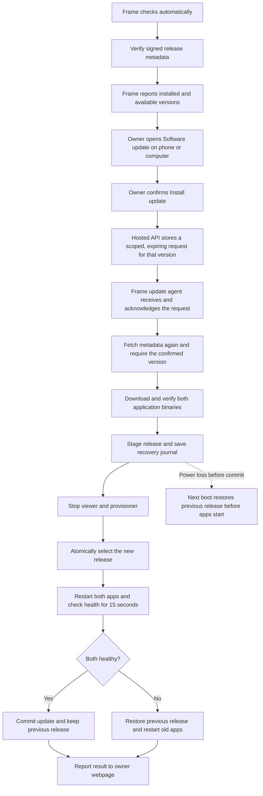

# Memory Lane application updater

The Pi is a headless appliance. Owners manage updates in the **webpage →
Settings → Software update**, using **Check for updates**, **Install update**,
and **Restore previous version**. No keyboard, mouse, local terminal, or SSH is
needed for normal use. A future phone app can use the same authenticated API.
The rustup-style CLI underneath is an operator maintenance tool.

The frame checks for signed releases automatically. Installation requires an
explicit owner request and confirmation in the webpage. This implementation
is local and has not been deployed to the hosted service or reference Pi.



A separate device agent polls every 15 seconds using the claimed device's
credential. The owner API scopes every request to the household and frame.
Requests are durable, have unique identities, and expire after 30 minutes.
Duplicate delivery or lost responses cannot re-execute a request. A request
names the exact release the owner confirmed; if the stable release changes,
installation fails safely and the owner checks/confirms again. Reset and update
requests exclude one another. The agent stays outside the app release switch.

The timer checks shortly after boot (10 minutes plus up to 30 minutes of jitter)
and daily thereafter. It only records a verified available version, which the
agent reports to the server. A failed check preserves the last verified result
and the existing installation. Installation always re-verifies fresh metadata.
The webpage shows queued/running/completed/failed requests, keeps controls
scoped to the selected frame, and identifies appliances without the updater.

Operator commands remain available for servicing:

```sh
memory-lane status
sudo memory-lane check
sudo memory-lane update
sudo memory-lane rollback
```

Both original executable paths become symlinks through
`/opt/memory-lane/current`, which selects a complete release directory. Both
services stop before the pointer changes. A flushed transaction journal is
written before the switch; the boot recovery service restores any uncommitted
switch before either application starts. Failed recovery blocks dependent
application services rather than starting an uncertain release.

Application identity, pairing credentials, NetworkManager configuration,
provisioning state and cached photos remain in their existing locations. The
updater does not modify those paths, service definitions, OS packages, or
itself during ordinary updates. `update` and `rollback` refuse an appliance in
Wi-Fi setup or factory reset. Once adopted, the baseline, current, and previous
release are retained; other completed release directories are pruned during
updates. Manual rollback also works offline and does not lower the highest
verified release sequence.

## Bootstrap an existing appliance

Build with `just pi-build`. The new binary is
`target/pi-bookworm/aarch64-unknown-linux-gnu/release/memory-lane`.
The Pi needs systemd and the existing application services; it needs no Cargo,
Python, OpenSSL command, curl, or browser.

Create a release signing key **on the operator workstation**, outside this
repository, using a protected directory and `umask 077`:

```sh
openssl genpkey -algorithm ED25519 -out /secure/location/memory-lane-release.pem
openssl pkey -in /secure/location/memory-lane-release.pem -pubout -outform DER -out /secure/location/memory-lane-release-public.der
python3 -c 'from pathlib import Path; p = Path("/secure/location/memory-lane-release-public.der").read_bytes(); assert p[:12].hex() == "302a300506032b6570032100" and len(p) == 44; print(p[12:].hex())'
```

Back up the private key securely. Only its raw 32-byte **public** key (64 hex
characters) goes on appliances. Provision this trust key through the attended
bootstrap, never from the channel being verified. There is no default test key,
trust-on-first-use download, automatic key rotation, or unsigned bypass.

Create `/etc/memory-lane-updater.json` using the intended stable-channel URL
and public key:

```json
{
  "manifest_url": "https://github.com/sjbeskur/astrohud/releases/latest/download/stable.json",
  "public_key": "REPLACE_WITH_64_HEX_CHARACTERS_FROM_YOUR_PUBLIC_KEY"
}
```

Copy the ARM64 updater, config, and this directory's `scripts`/`deploy` folders
to the appliance, then run the attended bootstrap there:

```sh
sudo bash scripts/install-updater.sh /path/to/memory-lane /path/to/updater-config.json
sudo memory-lane check
```

The bootstrap installs the updater, public configuration, recovery dependency
drop-ins, agent and timer; enables/starts the recovery service; and adopts existing
binaries as `baseline` without restarting the applications. Preserve any
existing per-device service customizations. Rebuilt clean images include the
updater and units, but still need the operator's public configuration and
`sudo memory-lane init` before the first application update. Do not reuse an
old image-only OS cache to introduce the updater into an already adopted
appliance image; produce a clean sealed image.

The recovery service must be active before `init`, `update`, or `rollback`.
`sudo memory-lane recover` restores an interrupted switch and restarts the
applications. Rebooting invokes recovery automatically before app startup.
For boot recovery failures, inspect `journalctl -u memory-lane-update-recover`
and repair the reported storage/service problem before restarting that unit.
Never remove `/opt/memory-lane` while original binary paths point into it.

## Publish a signed release

Cloudflare R2 is the selected test host. See [R2 and the guided Pi test](R2_TEST.md)
for the bucket, upload layout, and phone-side test sequence. Any public HTTPS
object host works; appliances do not need storage-account credentials.

The workstation-only packaging script uses Python's standard library and
OpenSSL. Build the two applications with the existing Bookworm ARM64 toolchain,
then package them using a monotonically increasing sequence and stable product
version. This is an example for a future release, not a published release:

```sh
python3 astrohud-updater/scripts/release.py \
  --version 0.6.0 --sequence 6 \
  --base-url https://github.com/sjbeskur/astrohud/releases/download/v0.6.0 \
  --key /secure/location/memory-lane-release.pem \
  --output target/releases/v0.6.0-updater
```

Upload `astrohud-frame`, `astrohud-provisioner`, and `stable.json` from that
bundle as release assets. Never overwrite binaries for an existing sequence;
publish a new release. The script refuses existing output directories. It
validates ELF architecture, hashes the copied binaries, and signs the exact
UTF-8 JSON payload using Ed25519. The manifest contains schema, version,
sequence, target, expiry, artifact sizes, hashes and HTTPS URLs. Payload JSON
is a string inside the signed envelope to avoid canonicalization ambiguity.

Metadata expires after 30 days by default (`--expires-days`, maximum 90).
Refresh and re-sign `stable.json` before expiry, retaining the same version,
sequence and binary contents when only extending freshness. On GitHub, the
`latest/download` URL must resolve to a release with this manifest; an unrelated
new release without it will make checks fail. Publication should upload all
assets before promoting that release to latest. Alternatively use a dedicated
stable-channel HTTPS endpoint. Appliance clocks must be synchronized.

The client limits metadata to 32 KiB and each binary to 64 MiB. HTTPS redirects
are allowed for release CDNs; HTTP redirects are refused. The release HTTP
client has no owner/device credentials. Expired, tampered, replayed,
wrong-target, oversized or corrupt releases fail before installed apps change.
Once a sequence/version is observed, ordinary updates cannot go backward;
explicit local rollback is the exception. This is a single-key signed channel,
not a full TUF implementation: there is no threshold signing or compromise
recovery through the channel itself.

## Validation and limits

```sh
cargo test -p astrohud-updater
cargo clippy -p astrohud-updater --all-targets -- -D warnings
python3 astrohud-updater/scripts/test-release.py
just pi-build
```

Health checks require both systemd services to remain active/running for 15
seconds without automatic restarts and verify `/proc/<pid>/exe` matches the
selected binaries. These are process-health checks; they do not prove rendered
pixels, Wi-Fi onboarding, cloud sync, or long-term reliability. Application
updates must preserve backward compatibility with persistent device data so
binary rollback remains safe. Updater upgrades, service-unit changes, OS
upgrades, native app UI and proactive update notifications remain separate work.

The website and API must deploy together. The additive server schema upgrade
is **12 → 13**, protected by the existing pre-migration database snapshot.
Production v0.5.1 and older binaries reject schema 13; application binaries on
the Pi are separate from this server rollback boundary. Use a schema-13-aware
forward fix or restore a coordinated database/media backup; do not deploy an
older server over a schema-13 database.

API contract (owners use the existing owner session; devices use their own
Bearer credential):

- `GET /api/beta/owner/frames/{frame_id}/updates`: latest report and request.
- `POST /api/beta/owner/frames/{frame_id}/updates`: `{ "action": "check" }`, or
  `update`/`rollback` with the exact `release_id` from the report.
- `POST /api/beta/device/updates`: bounded status report and optional request
  result; responds with that device's active command or `null`.

Browser regression checks create synthetic data against an isolated local
server; install Puppeteer separately or set `PUPPETEER_MODULE` to its ESM entry:

```sh
UPDATER_TEST_URL=http://127.0.0.1:18089 node astrohud-updater/scripts/test-web.mjs
```

Before shipping, validate an attended signed update, offline rollback, a bad
release, interrupted installation, and actual power loss on the reference Pi.
No production signing key, release publication, Pi installation, image flash,
or physical interruption test has been performed by the local implementation.
